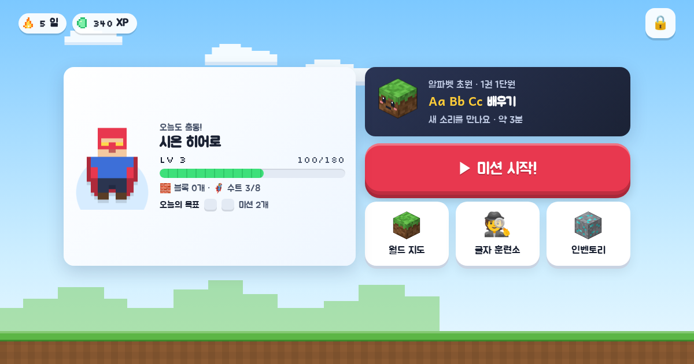

# 🧱 블록 히어로 파닉스 (Block Hero Phonics)

**블록 월드 × 히어로** 테마로 즐겁게 배우는 파닉스 웹앱이에요.
초등 저학년, 특히 **집중 시간이 짧은 아이(ADHD 성향)** 와 **천천히 배우는 아이**를 위해 설계했어요.

👉 **바로 하기: https://sung-park.github.io/sion-phonics/**
(아이패드·휴대폰·PC 브라우저에서 바로 돼요. 사파리에서 "홈 화면에 추가"하면 앱처럼 쓸 수 있어요.)

## 어떤 앱인가요?

- **3분 미션** – 한 번에 한 가지 소리만. 단원마다 `배우기 → 연습하기 → 보스 도전` 3개의 짧은 미션.
- **원어민 음성** – 모든 단어·문장·소리를 ElevenLabs로 미리 녹음해 두었어요. (브라우저 기계음 TTS를 쓰지 않아요)
- **교재와 같은 순서** – 리틀팍스 *Phonics Works 1–4* 의 단원 순서를 그대로 따라가요. 보호자 화면에서 "지금 공부 중인 단원"을 고르면 거기서부터 시작해요.
- **헷갈리는 글자 훈련소** – b/d, p/q, m/n, n/u, i/l, h/n, f/t 를 bed 트릭 같은 그림 기억법과 짧은 게임으로 구별해요.
- **틀려도 괜찮아** – 무서운 오답 소리·시간 제한이 없어요. 한 번 틀리면 소리를 다시 들려주고, 두 번째엔 정답이 반짝이는 힌트가 나와요(오류 없는 학습).
- **복습은 자동으로** – 틀렸던 소리·단어는 간격 반복(라이트너 상자)으로 다음 미션에 슬쩍 다시 나와요.
- **보상 · 보물 도감 96종** – 미션마다 보물상자! 진도에 따라 땅속으로 내려가듯 보상이 올라가요: 초원(흙·잔디·통나무) → 동굴(조약돌·석탄) → 광산(구리·철) → 정글·바다 유적(금·청금석) → 고대 도시(붉은돌·다이아몬드) → 지하세계(흑요석) → 끝의 차원(에메랄드·보물 블록). 나무→돌→철→금→다이아 곡괭이·검, 횃불·나침반 같은 모험 장비, 월드 클리어 때만 만나는 펫 친구 8종, 학교 영어에서 모으는 💿 말하기 디스크 9종, 학년 테마 블록(벚꽃 숲·사막 마을·눈 덮인 산·하늘 섬)·장비·펫, 🏅 학년 배지 4종, 💎 단어 보석 6종. 아직 못 찾은 보물은 실루엣으로 보여요. XP·레벨·연속 학습일, 월드마다 히어로 수트 파츠도 하나씩!
- **📚 이야기 책 (디코더블 북) 15권** – 단원 보스를 깨면 4–6쪽짜리 이야기 두루마리가 열려요. **그때까지 배운 파닉스 규칙 + 몇 개의 사이트워드로만** 써서 아이 혼자 읽을 수 있어요. 단어를 누르면 그 단어만, 🔊 "읽어 줘"를 누르면 문장을 읽어 주면서 읽는 단어에 불이 들어와요(ElevenLabs 글자 타이밍으로 맞춤). 읽은 책은 책장(인벤토리)에 모여요.
- **🗣️ 학교 영어 3–6학년 82개 대화** (3학년 22 · 4학년 20 · 5학년 20 · 6학년 20) – 2022 개정 교육과정의 학년별 의사소통 기능(인사·기분 → 시간·장소·가격 → 과거·계획·길 찾기·이유 → 비교·의견·제안·미래)을 큐비와 히어로의 짧은 대화로 익혀요. 3학년은 파닉스 진도와 상관없이 열려 있고 새 대화는 **하루 1개 또는 파닉스 미션 1개마다** 열려 두 트랙을 번갈아 해요. 4학년부터는 앞 대화를 끝내면 다음 대화가 열리고, 다음 학년은 앞 학년을 다 끝내거나 보호자 화면의 **학교 영어 학년** 설정으로 열어요.
- **📗 학년별 읽기 책 32권** (학년별 8권, 6–12쪽) – 블록 마을의 큐비·맥스·친구들 이야기. 대화를 끝내면 열리고, 다 읽으면 퀴즈 2–3문제. 이야기 책처럼 단어 누르기·읽어 주기(하이라이트) 지원.
- **🔤 단어 도감 525개** (3학년 137 · 4학년 132 · 5학년 126 · 6학년 130) – 끝낸 대화의 단어가 학년·주제별 카드로 모여요(그림 + 뜻 + 소리). 25·75·150·250·375·500개마다 💎 단어 보석.
- **히어로 꾸미기** – 홈에서 이름이나 히어로를 누르면 언제든 이름·색깔을 바꿀 수 있어요(진도는 그대로).
- **보호자 화면** (곱셈 문제로 잠금) – 교재별 진도·숙달도, 자주 틀리는 소리, 헷갈린 글자 짝(b→d 등), 최근 학습 기록, 설정.
- **차분 모드** – 애니메이션·반짝임을 줄여요. 한국어 음성 안내·효과음·미션 길이도 조절 가능.
- **설치·로그인 없음** – 진도는 (저장 키 `bhp.v1` 그대로, 새 필드는 기본값으로 추가되어 예전 진도도 그대로 이어져요) 이 기기 브라우저에만 저장돼요(내보내기/가져오기로 기기 이동 가능). 오프라인에서도 동작(PWA).

## 활동 종류

| 활동 | 설명 |
|---|---|
| 소리 배우기 | 글자를 누르면 이름과 소리, 그림을 누르면 키워드 단어 |
| 소리 듣고 고르기 | 들리는 소리의 글자(또는 글자 팀)를 골라요 |
| 첫소리 찾기 | 그림 단어가 어떤 소리로 시작하는지 |
| 대·소문자 짝 | 대문자에 맞는 소문자 찾기 |
| 블렌딩 | 블록을 하나씩 눌러 소리를 잇고 → 단어 전체로 "스르륵" |
| 단어 만들기 | 소리를 듣고 글자 블록을 순서대로 놓기 (blends는 낱글자, sh/ai 같은 팀은 한 블록) |
| 매직 e | cap 에 e 블록을 붙이면 → cape! 모음 소리가 바뀌는 걸 직접 체험 |
| 그림 고르기 | 단어를 읽고 맞는 그림 고르기 |
| 문장 읽기 | 해독 가능한 짧은 문장. 모르는 단어는 눌러서 듣고, 들린 단어를 문장에서 찾기 |
| 사이트워드 | 통째로 외우는 단어(4권 100개). 철자 듣기 → 따라 말하기 |
| 글자 찾기 | 화면 속 b 를 모두 찾아 누르기 (시간 제한 없음) |

### 학교 영어 활동 (레슨당 약 3–5분)

| 단계 | 설명 |
|---|---|
| 대화 듣기 | 큐비와 히어로의 2줄 대화. 말풍선을 누르면 다시 듣고, 큰 소리로 따라 말하기 |
| 표현 익히기 | 그림 카드 4–5장을 눌러 표현 듣기 (한국어 뜻 함께) |
| 듣고 고르기 | 들은 문장을 3개 중에서 고르기 |
| 그림 퀴즈 | 표현을 듣고 알맞은 그림 고르기 (2–3문제) |
| 대답 고르기 | 큐비의 질문에 알맞은 대답 고르기 |
| 글 읽기 (5–6학년) | 3–4문장 짧은 글 읽기(🔊 읽어 주기 + 하이라이트) → 질문에 답하기 |
| 문장 만들기 (5–6학년) | 한국어 뜻을 보고 낱말 카드를 순서대로 눌러 문장 완성 |
| 철자 맞히기 (5–6학년) | 그림·뜻을 보고 글자 카드를 눌러 단어 완성 (키보드 없음) |

## 📚 이야기 책 목록 (모두 오리지널)

| 월드 | 열리는 때 | 이야기 |
|---|---|---|
| 🌱 시작의 초원 | 1권 8단원 보스 | *A to Z Walk* (알파벳 산책) – 그림 키워드 단어 |
| 🪨 얕은 동굴 | 1권 9–13단원 보스 (단원마다 1권) | *Max and the Cat* (short a) · *The Hot Pot* (o) · *Ten Red Hens* (e) · *The Big Dig* (i) · *Bug Fun* (u) |
| ⛏️ 깊은 광산 | 2권 1–4단원 보스 (단원마다 1권) | *The Cave Game* (a_e) · *Five Kites* (i_e) · *Bob and the Bone* (o_e) · *The Huge Cube* (u_e) |
| 🌿 정글 신전 | 2권 7단원 보스 | *The Slime Stop* (blends) |
| 🌊 바다 유적 | 2권 13단원 보스 | *A Boat on the Sea* (vowel teams) |
| 🏛️ 고대 도시 | 3권 5단원 보스 | *The Deep Chest* (digraphs) |
| 🔥 불타는 지하세계 | 3권 12단원 보스 | *The Fire Storm* (r-controlled · oi · ou · oo) |
| 🌌 끝의 차원 | 4권 5단원 보스 | *Who Can Help?* (sight words) |

허용 사이트워드(하트 워드): a, the, I, is, to, and, of, you, he, she, we, was, said, go, no, so, my, do, are, his, has, as, look, see, they, what, this, that, with, help, out, into, thank, good, over, open, where, here, there, come, have, for, one, two, little, all, be, me, by, put, your, oh, in, on, it, at, an, not, can, up + 4권에서 이미 배운 사이트워드. (보호자 확인: 문장이 자연스럽도록 아주 기초적인 고빈도 단어 몇 개는 해당 파닉스 단원 전이라도 통째로 읽는 단어로 허용해요.) 등장인물 이름: Max(히어로), Cubi(큐비), Bob, Ted, June 등.
`node tools/validate_stories.mjs` 가 모든 단어를 검사해요: 열리는 단원까지 배운 그래핌(단모음 → 매직 e → 블렌드 → 모음 팀 → 이중글자 → r 모음 …)으로만 해독되는지, 아니면 이미 배운 단어/허용 사이트워드/이름인지. 하나라도 어긋나면 실패해요.

## 🗣️ 학교 영어 레슨 목록 (3–6학년, 모두 오리지널 대화)

2022 개정 교육과정의 학년별 의사소통 기능과 교육부 기본 어휘(초등 권장 800 + 기본 3,000)에 맞춰 직접 쓴 대화예요. `node tools/validate_curriculum.mjs` 가 학년별 어휘(기본 어휘 비율 90% 이상, 윗 학년 단어 개수 제한, 문장 길이)와 구조를 검사해요.

### 3학년 (22개 대화)

| # | 주제 | 대화 |
|---|---|---|
| 1 | 만나서 반가워 (인사하기) | Hello! I’m Cubi. / Hi, Cubi! Nice to meet you. |
| 2 | 네 이름은 뭐야? (이름 말하기) | What’s your name? / My name is Max. |
| 3 | 이건 뭐야? (물건 묻기) | What’s this? / It’s a pencil. |
| 4 | 일어나세요, 앉으세요 (교실 명령) | Stand up, please. / Okay! Sit down, Cubi. |
| 5 | 어떤 동물이야? (동물 말하기) | Look! It’s a tiger. / Wow! It’s big. |
| 6 | 무슨 색이야? (색깔) | What color is it? / It’s blue. |
| 7 | 기분이 어때? (안부·기분) | How are you? / I’m happy! |
| 8 | 나는 ~를 좋아해 (좋아하는 것) | I like apples. / Me too! I like bananas, too. |
| 9 | ~를 좋아하니? (좋아하는지 묻기) | Do you like pizza? / Yes, I do! |
| 10 | 몇 개야? (1–10) (수 세기) | How many apples? / Five apples! |
| 11 | ~할 수 있니? (할 수 있는 것) | Can you swim? / Yes, I can! |
| 12 | ~하지 마 (금지하기) | Don’t run, please. / Oh, sorry! |
| 13 | 몇 살이니? (나이 말하기) | How old are you? / I’m nine years old. |
| 14 | 우리 가족이야 (가족 소개) | Who is she? / She’s my mom. |
| 15 | 숫자 11–20 (큰 수 세기) | How many blocks? / Twelve blocks! |
| 16 | 날씨가 어때? (날씨) | How’s the weather? / It’s sunny! |
| 17 | 고마워! (감사하기) | Here you are. / Thank you, Cubi! |
| 18 | 내일 또 만나 (헤어질 때) | Goodbye! See you tomorrow. / Bye, Cubi! See you. |
| 19 | 나는 ~가 있어 (가진 것 말하기) | Do you have a ball? / Yes, I do. I have a red ball. |
| 20 | 이건 ~니? (확인하기) | Is it a dog? / No, it isn’t. It’s a cat. |
| 21 | 같이 ~하자! (제안하기) | Let’s play soccer! / Okay! Sounds good. |
| 22 | 내 몸을 움직여! (동작 지시하기) | Touch your nose. / Okay! Clap your hands, Cubi. |

### 4학년 (20개 대화)

| # | 주제 | 대화 |
|---|---|---|
| 1 | 이건 누구 거야? (소유 묻고 답하기) | Whose cap is this? / It’s mine. Thank you! |
| 2 | 어디 있어? (위치 묻고 답하기) | Where is my ball? / It’s under the bed. |
| 3 | 지금 몇 시야? (시각 묻고 답하기) | What time is it? / It’s eight o’clock. |
| 4 | ~할 시간이야 (할 일 말하기) | It’s time for lunch. / Great! I’m hungry. |
| 5 | 이거 얼마야? (가격 묻고 답하기) | How much is this robot? / It’s ten dollars. |
| 6 | 뭐 하고 있어? (하고 있는 일 말하기) | What are you doing? / I’m drawing a picture. |
| 7 | 오늘 무슨 요일이야? (요일 말하기) | What day is it today? / It’s Monday. |
| 8 | 몇 시에 일어나? (하루 일과 말하기) | What time do you get up? / I get up at seven. |
| 9 | ~ 좀 줄래? (요청하기) | Can I have some water? / Sure. Here you are. |
| 10 | 뭐 먹고 싶어? (원하는 것 말하기) | What do you want? / I want a hamburger. |
| 11 | 너 어디 있어? (있는 곳 말하기) | Where are you? / I’m in the kitchen. |
| 12 | 어떤 계절이 좋아? (좋아하는 계절 말하기) | What season do you like? / I like summer. I can swim! |
| 13 | 옷을 입어 (옷 입기 말하기) | It’s cold. Put on your coat. / Okay. Thanks, Cubi! |
| 14 | 이 사람은 누구야? (사람 소개하기) | Who is he? / He’s my brother. He’s tall. |
| 15 | 제일 좋아하는 건? (좋아하는 것 말하기) | What’s your favorite color? / My favorite color is green. |
| 16 | 몇 개 있어? (큰 수) (수량 묻고 답하기) | How many blocks do you have? / I have forty blocks! |
| 17 | 도와줄래? (도움 요청하기) | This box is heavy. Can you help me? / Sure. No problem! |
| 18 | 같이 갈래? (제안하고 거절하기) | Let’s go to the park. / Sorry, I can’t. I’m busy. |
| 19 | 생일 축하해! (축하하고 선물 주기) | Happy birthday! This is for you. / Wow, thank you! I love it. |
| 20 | ~할 수 있니? (탈것·악기) (능력 묻고 답하기) | Can you ride a bike? / Yes, I can. It’s fun! |

### 5학년 (20개 대화 · 짧은 글 읽기·문장 만들기·철자 포함)

| # | 주제 | 대화 |
|---|---|---|
| 1 | 어디에서 왔어? (출신 묻고 답하기) | Where are you from? / I’m from Korea. How about you? |
| 2 | 방과 후에 뭐 해? (일과 묻고 답하기) | What do you do after school? / I play soccer with my friends. |
| 3 | 어제 뭐 했어? (한 일 묻고 답하기) | What did you do yesterday? / I watched a movie. |
| 4 | 주말 어땠어? (경험 말하기) | How was your weekend? / It was great! I went camping. |
| 5 | 어디 아파? (아픈 곳 말하기) | What’s wrong? / I have a headache. |
| 6 | ~해도 돼요? (허락 구하기) | May I come in? / Yes, you may. Come on in! |
| 7 | 길 찾기 (길 묻고 안내하기) | How can I get to the library? / Go straight and turn left. |
| 8 | 어디에 있어? (건물) (건물 위치 말하기) | Where is the hospital? / It’s between the school and the park. |
| 9 | 이번 주말에 뭐 할 거야? (계획 묻고 답하기) | What are you going to do this weekend? / I’m going to visit my uncle. |
| 10 | ~하는 게 어때? (제안하기) | Why don’t we play baseball? / That’s a good idea! |
| 11 | 꿈이 뭐야? (장래 희망 말하기) | What do you want to be? / I want to be a scientist. |
| 12 | 얼마나 자주 해? (빈도 말하기) | How often do you exercise? / Three times a week. |
| 13 | 어떻게 생겼어? (외모 묘사하기) | What does your sister look like? / She has long hair. |
| 14 | 왜? 왜냐하면… (이유 묻고 답하기) | Why are you so happy? / Because today is my birthday! |
| 15 | 오늘 며칠이야? (날짜 말하기) | What’s the date today? / It’s May fifth. |
| 16 | 뭘 주문할래? (음식 주문하기) | What would you like? / I’d like a sandwich, please. |
| 17 | 이 신발 얼마예요? (물건 사기) | How much are these shoes? / They’re twenty dollars. |
| 18 | 취미가 뭐야? (취미 말하기) | What’s your hobby? / My hobby is collecting cards. |
| 19 | 고마워! 천만에 (감사하고 칭찬하기) | Thank you for helping me. / You’re welcome. |
| 20 | 조심해! (주의 주기) | Watch out! A car is coming. / Oh! Thank you. |

### 6학년 (20개 대화 · 짧은 글 읽기·문장 만들기·철자 포함)

| # | 주제 | 대화 |
|---|---|---|
| 1 | 누가 더 커? (비교하기) | Who is taller, you or me? / I’m taller than you! |
| 2 | 가장 ~한 건? (최상급으로 말하기) | What’s the biggest animal in the world? / The blue whale is the biggest. |
| 3 | 내 생각은… (의견 말하기) | What do you think of this picture? / I think it’s beautiful. |
| 4 | ~하는 게 좋겠어 (충고하기) | I’m so tired today. / You should go to bed early. |
| 5 | 학교에 어떻게 가? (교통수단 말하기) | How do you go to school? / I go to school by bus. |
| 6 | 방학 계획 (미래 계획 말하기) | What will you do this summer vacation? / I’ll travel to Jeju with my family. |
| 7 | 생일이 언제야? (달·날짜 말하기) | When is your birthday? / It’s in July. How about you? |
| 8 | 방학에 뭐 했어? (지난 일 말하기) | What did you do last vacation? / I went to Busan. I saw the sea. |
| 9 | 빌려줄 수 있어? (부탁하고 허락하기) | Can I borrow your eraser? / Sure. Here you go. |
| 10 | 어느 계절이 제일 좋아? (선호와 이유 말하기) | Which season do you like best? / I like fall best. |
| 11 | 지구를 지켜요 (해야 할 일 말하기) | Look at all this trash! / We should pick it up. |
| 12 | 무슨 일이야? (아픈 곳 말하고 위로하기) | What’s the matter? / I hurt my leg. |
| 13 | 함께 할래? (초대하고 답하기) | Will you come to my party? / Sure, I’d love to. |
| 14 | 어떤 일을 하셔? (직업 묻고 답하기) | What does your mom do? / She’s a firefighter. |
| 15 | 어땠어? (감상 말하기) | How was the movie? / It was exciting! |
| 16 | 나는 ~를 잘해 (잘하는 것 말하기) | What are you good at? / I’m good at drawing. |
| 17 | 우리 동네 소개 (장소 묘사하기) | Tell me about your town. / There is a big park. |
| 18 | 어떻게 만들어? (순서 설명하기) | How do you make a sandwich? / First, put cheese on the bread. |
| 19 | 미래의 나 (꿈과 이유 말하기) | What do you want to be in the future? / I want to be an inventor. |
| 20 | ~해야 해서 못 가 (해야 할 일 말하기) | Let’s play outside! / Sorry, I have to do my homework. |

3학년 짝수 레슨(2, 4, … 18)을 처음 끝내면 💿 말하기 디스크, 4–6학년은 5번째 레슨마다 학년 테마 장비, 학년을 모두 끝내면 🏅 학년 배지와 펫 친구를 받아요.

## 📗 학년별 읽기 책 (모두 오리지널)

해당 학교 영어 대화를 끝내면 열려요. 다 읽으면 내용 확인 퀴즈(2–3문제). 아직 안 배운 단어는 작은 한국어 뜻이 붙어요.

| 학년 | 책 (쪽수) |
|---|---|
| 3학년 | Hello, Block Town! (6) · The Color Blocks (6) · Lunch at the Zoo (7) · Can You Swim, Cubi? (6) · My Hero Family (6) · A Snowy Day (6) · Where Is My Ball? (6) · Hero Training (6) |
| 4학년 | Whose Pickaxe? (8) · Wake Up, Cubi! (8) · The Block Shop (8) · What Are You Doing? (8) · Max’s Busy Day (8) · The Four Doors (8) · The Rainy Picnic (8) · A Birthday Surprise (8) |
| 5학년 | Doctor Cubi (10) · The Lost Map (10) · The Weekend Plan (10) · The Big Race (10) · A Hero Every Day (10) · The Sleepy Dragon (10) · Cubi’s Cafe (10) · A Letter from Jun (10) |
| 6학년 | The Smallest Car (11) · The Island Trip (11) · The Time Machine (12) · Save the Ocean (11) · The Robot Who Wanted a Friend (11) · Lost in the Museum (11) · Cubi’s Big Dream (12) · Goodbye, Elementary School (12) |

## 커리큘럼 (Phonics Works 1–4 순서)

| 월드 (점점 더 깊고 위험한 곳으로!) | 교재 | 단원 |
|---|---|---|
| 🌱 시작의 초원 | 1권 1–8 | Aa Bb Cc · Dd Ee Ff · Gg Hh Ii · Jj Kk Ll · Mm Nn Oo · Pp Qq Rr · Ss Tt Uu Vv · Ww Xx Yy Zz |
| 🪨 얕은 동굴 | 1권 9–13 | short a (at ad ap) · o (ot og op) · e (et en ed) · i (ig it in) · u (ug ut un) |
| ⛏️ 깊은 광산 | 2권 1–4 | magic e: a_e · i_e · o_e · u_e |
| 🌿 정글 신전 | 2권 5–7 | blends: cl pl gl · fr dr gr · sp sl st |
| 🌊 바다 유적 | 2권 8–13 | long-vowel teams: ai ay · ea ee · ie igh · y · oa ow · ue ew |
| 🏛️ 고대 도시 (심층 어둠) | 3권 1–5 | digraphs: ch sh · ph wh · qu ck · th · ng nk |
| 🔥 불타는 지하세계 | 3권 6–12 | oi oy · ou ow · oo · a au aw · ar or · er ir ur · wr kn |
| 🌌 끝의 차원 (마지막 보스) | 4권 1–20 | 100 sight words (단원별 4–8개) |

단어·문장·그림은 모두 이 앱을 위해 새로 만든 것이고, 교재 내용(본문·그림)은 사용하지 않았어요. 교재의 *단원 순서와 목표 소리*만 맞췄어요.

## 보호자 팁

- 하루 **1–2개 미션(3–5분)** 이면 충분해요. "오늘의 목표" 2칸이 채워지면 끝!
- 블렌딩에서는 아이가 **소리를 입으로 따라 하게** 해 주세요 (c‑a‑t → cat).
- b/d가 헷갈리면 두 손 엄지척, 주먹끼리 마주 보게 해서 **왼손 = b, 오른손 = d** (왼쪽부터 b‑e‑d, 침대 모양!)를 함께 만들어 보세요.
- 보호자 화면은 🔒 버튼 → 곱셈 문제로 들어가요.

## 만든 방법 (개발자용)

- 순수 정적 사이트 (Vanilla JS ES modules, 빌드 없음) – GitHub Pages 하위 경로에서 동작하도록 모두 상대 경로.
- `js/data.js` 커리큘럼 · `js/phonics.js` 그래핌 분절(매직 e, 이중글자, y/th/oo/ow 예외) · `js/missions.js` 미션 생성·간격 반복 · `js/activities.js` 활동 · `js/sprites.js` 직접 그린 픽셀/복셀 SVG.
- `js/stories.js` 이야기 책 · `tools/validate_stories.mjs` 해독 가능성 검사 · `js/talk.js`·`talk_g4/5/6.js` 학교 영어 대화 · `js/readers.js` 학년별 읽기 책 · `tools/validate_curriculum.mjs` 학년별 어휘 검사 (`tools/elem800.txt`·`basic3000.txt`: 교육부 기본 어휘 목록에서 추출).
- 음성: `tools/gen_audio.py` (단어·문장·칭찬·한국어 안내, 이야기 쪽 음성은 단어별 타이밍 `assets/audio/st/timings.json` 포함, 학교 영어·퀴즈 `tk/`, 읽기 책·5–6학년 글은 `st/`에 타이밍 포함). 서비스 워커는 앱 코드만 미리 받고, 음성·그림은 처음 재생할 때 받아 업데이트 후에도 유지되는 별도 캐시(`bhp-media-1`)에 저장해요, `tools/gen_letters.py` (알파벳 낭독에서 글자 이름 분리), `tools/gen_phonemes.py` (단어 속에서 음소를 잘라내 'buh' 없는 짧은 자음, 늘인 연속음 생성). API 키는 환경 변수 `ELEVENLABS_API_KEY` 로만 읽고 저장하지 않아요. 결과는 `assets/audio/` + `manifest.json`.
- 오디오 검수 메모: [`docs/AUDIO.md`](docs/AUDIO.md)
- 로컬 실행: `python3 -m http.server` 후 `http://localhost:8000/`

## 저작권·크레딧

- 블록·히어로·마스코트(큐비) 그래픽: 이 프로젝트에서 직접 그린 오리지널 SVG.
- 그림 아이콘: [Twemoji](https://github.com/jdecked/twemoji) © Twitter/X & contributors, **CC‑BY 4.0**.
- 글꼴: Andika (SIL OFL), Jua, Silkscreen (Google Fonts, OFL).
- 음성: ElevenLabs 로 생성 (영어: Jessica, 한국어: Annie KR).
- 낱소리(파닉스 음소) 26개: [Open Letter Sounds](https://github.com/purplecomputerorg/openlettersounds) © Purple Computer, **CC0 1.0** (사람이 검수한 a–z 소리). 나머지 이중자음·모음팀 소리는 ElevenLabs로 직접 만들었어요. 자세한 출처: `assets/audio/p/CREDITS.md`
- 이 앱은 특정 게임·영화·출판사(리틀팍스 포함)와 관련이 없는 비영리 가족 학습용 프로젝트예요.
